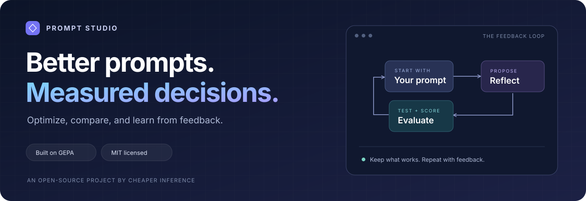
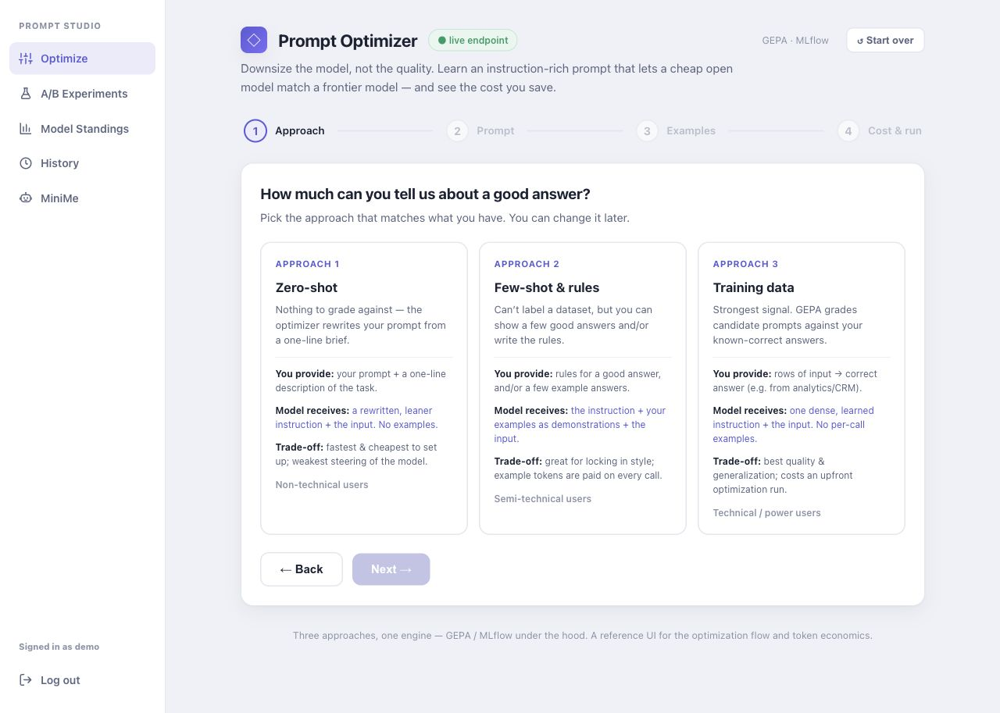
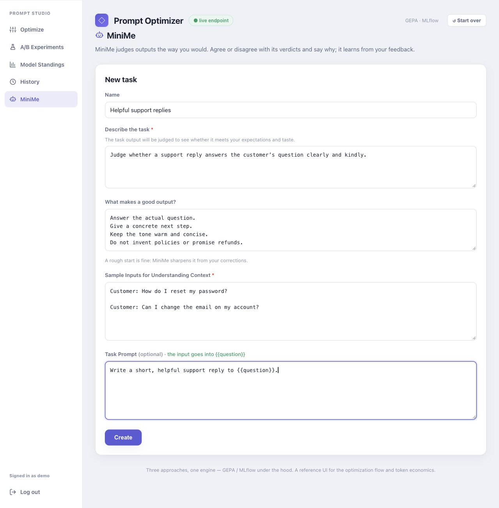

# Prompt Studio



<p align="center">
  <strong>MIT licensed · Self-hosted · Python 3.11–3.12 · GEPA + MLflow</strong><br/>
  <a href="#quick-start">Quick start</a> ·
  <a href="#take-a-look">Screenshots</a> ·
  <a href="#use-it-from-python">Python library</a> ·
  <a href="webapp_django/README.md">Deployment guide</a>
</p>

Turn a starting prompt into something you can test, compare, and reuse.
Prompt Studio brings [GEPA](https://gepa-ai.github.io/gepa/)'s reflective prompt
optimization into a visual workspace, with a Python library underneath.

Bring your own OpenAI-compatible endpoint. Define what a good answer looks like,
try candidate prompts, compare outcomes, and export the prompt you want to use.
Experiment with a less expensive task model while checking whether quality holds
on your evaluation data. Results depend on your task, models, and scoring criteria.

## What's inside

| Feature | What you can do |
| --- | --- |
| **Three ways to optimize** | Start from a task description, a few examples and rules, or labeled training data. |
| **Models by role** | Choose separate task, reflection, and judge models from your endpoint. |
| **A/B experiments** | Compare changes against a saved run using held-out inputs. |
| **MiniMe** | Review judging decisions, explain disagreements, and refine a judge prompt from your feedback. |
| **Constraints and rubrics** | Define quality criteria and check formats, fields, line counts, or allowed answers. |
| **Run history and model standings** | Revisit saved results and inspect measured latency by model and role. |
| **Reusable output** | Export prompts, variables, model settings, and available scores through the Python library. |
| **Durable jobs** | Run the web process and queue worker together, with job state stored locally. |

## Take a look

**Choose the signal you have.** The guided flow starts with zero-shot, few-shot,
or labeled training data, then walks through prompts, examples, and run settings.



<details>
<summary><strong>Meet MiniMe: teach a judge what good looks like</strong></summary>

Describe a task and its requirements, add sample inputs, then review and correct
judgments as you work. MiniMe uses that feedback to improve its judge prompt.



</details>

*Screenshots show the real UI with synthetic inputs and a local mock model
catalog. They illustrate setup, not measured model performance or savings.*

## Pick your starting point

| You have… | Choose | Evaluation signal |
| --- | --- | --- |
| A task description | **Zero-shot** | A description-guided rewrite; validate it separately before deployment. |
| Examples and/or written rules | **Few-shot** | Judge candidate outputs against your criteria and optional reference answers. |
| Inputs with known-correct answers | **Training data** | Score candidate outputs against labeled examples. |

For data-backed optimization, GEPA proposes prompt changes from execution
feedback and keeps promising candidates. Task and judge calls evaluate those
candidates. Zero-shot uses a separate description-guided rewrite path.
Keep held-out data separate from the examples used to optimize.

## Quick start

Use **Python 3.11 or 3.12**. Run these commands from the repository root.

```bash
git clone https://github.com/cheaper-inference/prompt-studio.git
cd prompt-studio
python3.12 -m venv .venv
source .venv/bin/activate
python -m pip install -r requirements.txt
```

Configure your endpoint and local Django session. Replace the two endpoint
placeholders with your own values; the variable names also work with other
OpenAI-compatible providers.

```bash
export CHEAPERINFERENCE_API_KEY="YOUR_API_KEY"
export CHEAPERINFERENCE_BASE_URL="https://your-provider.example/v1"
export DJANGO_SECRET_KEY="$(python -c 'import secrets; print(secrets.token_urlsafe(64))')"
export DJANGO_DEBUG=1
```

Create a local account and start the application:

```bash
python webapp_django/manage.py migrate
python webapp_django/manage.py adduser demo  # prompts for your password
python run_service.py
```

Open **[localhost:8000](http://localhost:8000)** and sign in. Pick model IDs your
endpoint actually serves for each role before starting a run. `run_service.py`
starts both the web process and queue workers; running only Django's development
server does not start the durable worker.

Optimization and judging call your provider and can incur charges. Start with a
small evaluation set and a modest call budget. No database or model weights are
bundled: SQLite databases are created locally, and the optional research worker
has its own explicit artifact setup.

Keep your generated Django secret stable across processes and restarts. The
commands above are for local HTTP development; public deployments need HTTPS,
debug disabled, and explicit host/proxy configuration. See the
[deployment guide](webapp_django/README.md#deploy-railway--docker) and
[environment template](.env.example). Django reads exported variables; copying
`.env.example` alone does not configure it. Optional delegated-credential jobs
also need the persistent encryption key described in that template.

## Use it from Python

The web app and the library share the same optimizer. After installing the root
requirements and exporting your endpoint variables, save this as a Python script
at the repository root. Replace the three model IDs with models your endpoint
serves.

```python
from llm_endpoint import configure
from prompt_optimizer import Mode, OptimizationConfig, Prompt, PromptOptimizer

endpoint = configure(
    task_model="your-task-model",
    reflection_model="your-reflection-model",
    judge_model="your-judge-model",
)
optimizer = PromptOptimizer(endpoint=endpoint, tracking_uri="sqlite:///mlflow.db")

result = optimizer.optimize(OptimizationConfig(
    name="friendly_support",
    mode=Mode.FEW_SHOT,
    prompts=[Prompt(template="Answer this support question clearly: {{question}}", role="user")],
    examples=[
        {"question": "How can I reset my password?"},
        {"question": "Where can I change my email address?"},
        {"question": "How do I download an invoice?"},
    ],
    input_keys=["question"],
    quality_criteria=[
        "Answer the question directly and concisely.",
        "Give a concrete next step without inventing product-specific policies.",
    ],
    max_metric_calls=10,
))

print(result.summary())
deployable = result.to_deployable()
print(deployable)
```

The exported object includes prompt messages, variables, model information, and
available scores. See the [engine guide](docs/ENGINE_GUIDE.md) for configuration,
constraints, the three optimization modes, and evaluation notes.

## Explore the project

| Start here | What's there |
| --- | --- |
| [Web app guide](webapp_django/README.md) | Local setup, environment settings, deployment, and browser routes. |
| [Engine guide](docs/ENGINE_GUIDE.md) | Python configuration and evaluation behavior. |
| [Environment template](.env.example) | Documented settings with placeholders. |
| [Research worker](workers/optimization/README.md) | Optional, separately deployed LLMLingua2, SoT, embedding, and verification operations. |
| [Third-party notices](THIRD_PARTY_NOTICES.md) | Upstream attribution and asset license boundaries. |

The main app is Django with SQLite and a server-rendered frontend: no Node.js
build is required. The research worker is independent and is not needed to run
Prompt Studio's core optimization workflow.

## Contribute

Bug reports, focused improvements, and reproducible evaluation examples are
welcome. Include the relevant mode, configuration, expected behavior, and
sanitized steps to reproduce. Use synthetic inputs when sharing examples.

Run the offline checks from the repository root after installing dependencies:

```bash
export DJANGO_SECRET_KEY="$(python -c 'import secrets; print(secrets.token_urlsafe(64))')"
python test/test_prompt_optimizer.py
python -m unittest test.test_llm_endpoint test.test_config_security
python webapp_django/manage.py test optimizer
```

The separate worker has its own [lightweight contract tests](workers/optimization/README.md#offline-contract-tests).

## Built on GEPA

Prompt Studio builds on [GEPA](https://github.com/gepa-ai/gepa), the reflective
prompt optimizer, and [MLflow](https://github.com/mlflow/mlflow). GEPA's upstream
copyright and MIT notice are preserved in [licenses/GEPA-LICENSE](licenses/GEPA-LICENSE).
If you use GEPA in research, see its [citation guidance](https://gepa-ai.github.io/gepa/#citation).

Prompt Studio's original code and README artwork are [MIT licensed](LICENSE).
Third-party code, prompts, dependencies, and model artifacts retain their own
terms; see [THIRD_PARTY_NOTICES.md](THIRD_PARTY_NOTICES.md).
